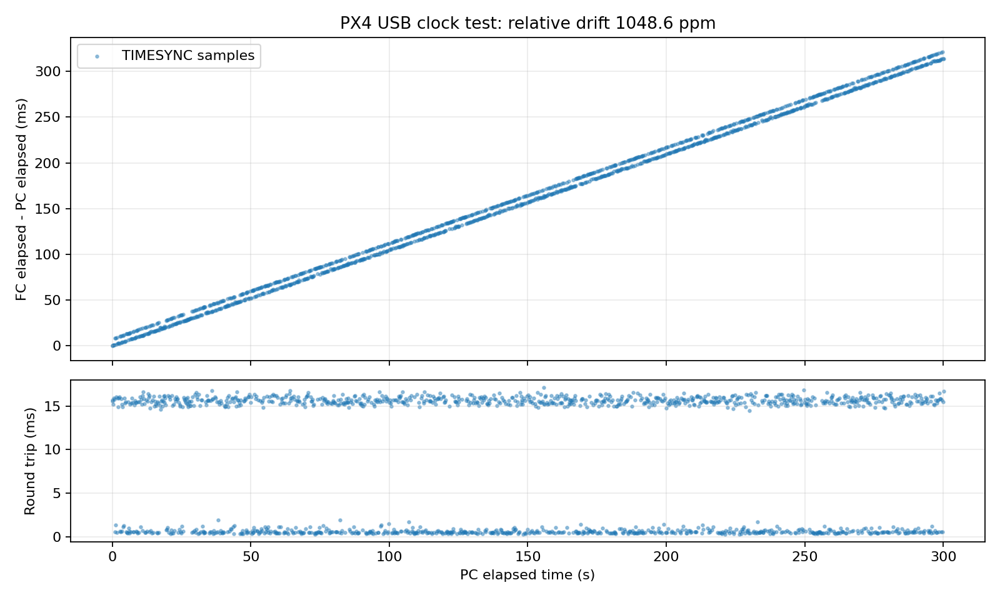
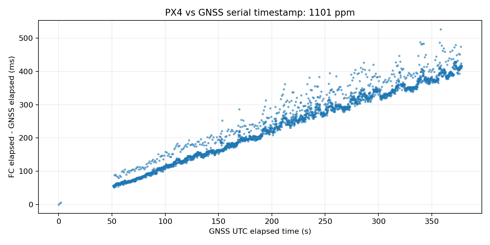

# 2026-11-27至28 数传与飞控计时复核

## 当前结论

1. LR900-A 最初误接 GPS 接口，收到的是 UBX GPS 配置报文；用户改接 UART1/TELEM1 后确认通信恢复。此前 TELEM1 的 MAVLink 配置正确。
2. USB TIMESYNC 与 GNSS 串口 UTC 两种对比均观察到飞控计时偏快，量级约 **+1000～1100 ppm（约0.1%，每秒多走约1 ms）**。
3. 这是计时频偏的复核证据，**不是晶振硬件频率的校准结果**。两轮参考、时段与延迟条件不同，不应平均成一个“精确校准值”。
4. 未测 PPS、MCO、冷启动温漂或飞行性能；没有修改飞控时钟、刷固件或写入补偿参数。

## 实物与连接边界

- 地面站识别为 `MicoAir743v2`，固件 PX4 1.16.2；用户本轮提供35A AIO手册。旧资料中的45A实物记录不能据此覆盖，当前板的完整型号/硬件修订仍应按丝印归档。
- USB飞控为 COM16；LR900-A 地面端为 COM18（CH340）；COM7为调试器，不作为飞控计时测试口。
- ELRS使用 UART6；LR900使用 UART1/TELEM1；本轮 Nano 未连接。历史 Nano 使用同一个 UART1，重新接回时需要重新分配端口，不能直接并联。
- GNSS为 BZGNSS BZ-251 GPS，六线标识为 TX、RX、GND、5V、SCL、SDA；**没有通过这六根线接入独立 PPS**。模块旁的PPS指示灯不能替代硬件捕获接线。
- 采样程序在开始时检查飞控未解锁；测试只读取状态、请求时间回复或运行只读 `listener`，不发送解锁/电机指令。

## LR900-A通信故障定位

配置截图及 `mavlink status` 确认实例0：

```text
TELEM1 / /dev/ttyS0 @57600
mode: Normal
flow control: OFF
Forwarding: Off
tx rate max: 1200 B/s
tx: 456.1 B/s
txerr: 0.0 B/s
rx: 0.0 B/s
MAVLink version: 1
```

两端数传绿灯常亮，证明已对频，但不证明飞控串口接线正确。COM18按57600、8N1、无流控接收时出现 `B5 62 06 8A`（UBX-CFG-VALSET）和 `B5 62 06 00`（UBX-CFG-PRT），提示来源为GPS配置链路。用户随后确认误接GPS口，改线后恢复。未把流控、波特率或Nano占用认定为故障原因。

## 测试一：USB TIMESYNC相对电脑计时

- 时间：2026-11-27，文件开始标记23:08:09（Asia/Shanghai）。
- 电脑参考：Python `time.perf_counter_ns()`单调计时器，未校准其绝对频率。
- 每约0.2秒发送TIMESYNC请求，配对请求与回复，以电脑发送/接收时刻中点对应飞控回复时间；记录往返时延RTT。
- 对飞控与电脑的经过时间作线性拟合；低延迟分析保留RTT不超过全体中位数的样本。

| 指标 | 实测 |
|---|---:|
| 有效回复 | 1444组 |
| 全样本跨度 | 300.0536 s |
| 全样本拟合 | +1047.47 ppm |
| 低延迟样本 | 722组，跨度298.5814 s |
| 低延迟拟合 | +1048.58 ppm |
| RTT中位数 | 15.151 ms |
| 全样本/低延迟残差RMS | 3.682 / 2.255 ms |
| 低延迟结果换算 | 每100 s约多走104.86 ms |

每分钟单独筛选低延迟样本的拟合值约为1060.7、1055.0、1034.0、1054.3、1062.1 ppm。分段差异包含通信抖动，不能直接解释为温漂。原计划长测，实际本轮完成约5分钟；没有形成30分钟结果，也没有温度记录。



## 测试二：GNSS原始UTC与飞控计时

初次室内检查无有效定位、零星。用户随后将模块移到室外，并确认搜星。正式采集时保持3D定位，卫星数14～21。

通过MAVLink SERIAL_CONTROL读取 `listener sensor_gps`，提取同一消息中的 `timestamp`、`timestamp_time_relative`、`time_utc_usec`，采用：

```text
飞控对应时间 = timestamp + timestamp_time_relative
独立参考时间 = time_utc_usec（GNSS模块提供）
```

本次 `timestamp_sample=0`、`timestamp_time_relative=0`，没有硬件PPS采样时刻。不能用MAVLink报文在电脑的到达时间代替上述字段，也不能把 `SYSTEM_TIME` 当作独立GNSS参考。

| 指标 | 实测 |
|---|---:|
| 有效消息 | 3105组 |
| GNSS UTC首尾跨度 | 378.099964 s |
| 整体线性拟合 | +1101.13 ppm |
| 换算 | 每100 s约多走110.11 ms |
| 拟合残差RMS | 19.395 ms |
| 定位/卫星数 | 3D，14～21颗 |

按GNSS时间每60秒分段，拟合值约1105.6、1280.7、1097.1、1403.8、1079.1、1104.9 ppm；末段仅18秒，约1411.1 ppm，不作为稳态结论。分段波动与残差明显大于USB测试。

**采集完整性说明：**正式文件开头含上一轮listener的少量尾部消息，随后有约50秒采集空档；3105组数据覆盖378秒，不是连续378秒等间隔采样。图中可见空档。另有一份前期短试采集文件，未作为最终统计文件。此轮listener打印量、串口调度和接收延迟均可能影响结果，不能据此声称1101 ppm是晶振真值。



## 频偏定义与应用影响

```text
频偏ppm = (飞控经过时间 / 参考经过时间 - 1) × 1000000
```

正值表示飞控走得快。约1050 ppm对应每秒多走1.05 ms；不是“每秒3～4 ms”。“飞控100 s对应实际99.962 s”约为+380 ppm，也不是本机本轮测量值。

普通参数读写和遥测显示通常不依赖两端严格同步。视觉/VIO与IMU融合需要真实采样时间戳及持续时间同步；只开机同步一次，按1050 ppm估算一分钟后可重新积累约63 ms偏移。同步用于时间轴映射，不会物理校正晶振或消除传输延迟。飞控内部积分、调度等实际影响尚未测量，不能由通信测试推断飞行性能合格。

## 下一步

1. 核对BZ-251是否有可接出的PPS/TP焊盘和电平，再确认AIO可用输入捕获引脚及PX4支持情况；不要凭PPS灯直接焊线。
2. 用有效GNSS PPS配合硬件捕获，或用已知时基精度的频率计测MCO，复核独立时钟频率。
3. 按冷启动/热机分段并记录温度，重复测量；本轮没有温漂曲线。
4. 在Nano/VIO链路验证持续TIMESYNC、时间戳换算和同步剩余误差。
5. 只有确认计时来源和独立频偏后，才评估底层时基补偿或晶振硬件处理；不得直接将本轮拟合值写入固件。

## 证据与复现文件

已归档到 [附件/2026-11-28-飞控计时](附件/2026-11-28-飞控计时)：

- `samples_20261127_230809.csv`：USB原始时间戳与RTT。
- `analysis.json`、`clock_drift.png`：USB统计和图。
- `gnss_clock_20261128_001320.txt`：GNSS原始listener输出（包含位置数据，分享前检查）。
- `gnss_analysis.json`、`gnss_clock_drift.png`：GNSS统计和图。
- `measure.py`、`analyze.py`、`plot.py`、`gnss_clock.py`、`analyze_gnss.py`、`plot_gnss.py`、`gps_check.py`：本次实际使用的脚本快照。脚本不是自动校准工具；重跑前须核对串口、持续时间、输出路径和已安装依赖。

原工作目录：`E:\湘大\RM\逐曦\进度汇报\RM\outputs\clock_test`。附件不复制Python依赖；运行需Python、pyserial、pymavlink，绘图另需matplotlib。JSON中的绝对路径保留原始运行来源，原始日志可能包含预试尾部数据，复核时必须保留这一限制。

## 参考

- [微空35A AIO手册](https://micoair.com/zh/docs/flight-controller/micoair743-aio-series/micoair743v2-aio-35a-manual)
- [LR900配置教程](https://micoair.com/zh/docs/telemetry/px4-telemetry-configuration-tutorial)
- [PX4 1.16.2 TIMESYNC实现](https://github.com/PX4/PX4-Autopilot/blob/v1.16.2/src/modules/mavlink/mavlink_timesync.cpp)
- [PX4 1.16.2 SensorGps字段](https://github.com/PX4/PX4-Autopilot/blob/v1.16.2/msg/SensorGps.msg)

返回 [[00-测试总览]]、[[测试记录/README|测试记录索引]]。
