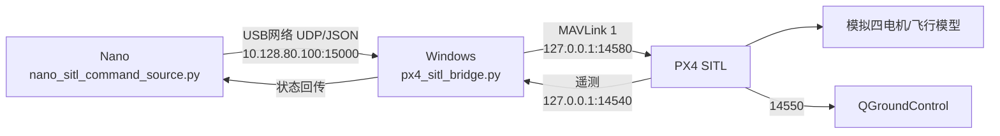

# 07 分段联调、SITL闭环与退出条件

前置：[[03-ELRS与MTF]]、[[04-Lichee与MAVLink]]、[[05-GC4653视觉链路]]、[[06-无桨电机测试]]。

> [!important] 当前状态：尚未完成真实端到端执行
> 已通过的是两项分段测试：① Nano命令到达PX4内部控制目标；② QGC通过PX4逐路驱动真实电机。尚未验证`Nano命令 → PX4进入执行状态 → 真实电机响应`，因此不得写成“端到端控制已通过”。

## Nano发起MAVLink电机测试方案评审（未执行）

候选方案是由Nano经TELEM1发送`MAV_CMD_DO_MOTOR_TEST`，让PX4使用自身的Actuator/Motor Test通道短时驱动单个电机，并保持飞控Disarmed。该方法如果实测通过，可以证明：

```text
Nano程序
→ UART1/TELEM1
→ MAVLink COMMAND_LONG解析与ACK
→ PX4执行器测试分发
→ Motor功能映射
→ DShot300
→ AM32 ESC
→ 指定真实电机
```

它应命名为“**Nano发起的命令到执行器测试链路**”。它不经过速度/位置、姿态、角速度等飞行控制环，也不验证Offboard模式、控制分配动态、解锁流程、飞行失联处置或真实闭环，因此不能等同于“Nano已完成飞行控制端到端验证”。

### 对候选程序的必要优化

1. 删除“自动依次测试全部电机”功能；每次进程只允许显式指定一个电机，默认不执行任何输出。
2. 在程序内部固定较低输出上限和极短持续时间，命令行不能突破；禁止同时驱动多路。
3. 启动时先发送全路停止；正常退出、异常、串口错误和`Ctrl+C`都必须进入同一个`finally`清理流程，再次发送全路停止。
4. 持续监测PX4心跳，不只在启动时等待一次；心跳陈旧、目标sysid/compid不符或串口接收停止时，不得继续下发测试。
5. `COMMAND_ACK`必须核对对应命令ID和结果，不能把其他命令的ACK误认为电机测试成功；拒绝、超时和未知结果均按失败处理。
6. 下发前必须从PX4状态确认`Disarmed`；如果检测到Armed、状态不明或QGC正在进行另一项Actuator Test，立即拒绝执行。
7. 保留PX4命令自身的超时，同时设置Nano侧独立的更短看门狗；不能只依靠程序最后补发一次零输出。
8. 程序不得加入开机自启动、自动重试或断线重连后恢复输出；测试完成后将`COM_MOT_TEST_EN`恢复为禁用状态。
9. 日志必须记录单调时间戳、电机编号、请求输出、持续时间、飞控心跳年龄、ACK和停止动作，便于确认没有延迟命令在重连后执行。

### 实物测试安全门禁

- 全部拆桨、电机逐个牢固固定，人员避开电机旋转平面；首次只测单路。
- 操作者手边直接控制4S物理断电；QGC Stop、RC急停和软件停止只作辅助，不能替代拔掉主电源。
- 测试期间监控`battery_status`、电压、瞬时电流、异常温升、声音和重启；任何异常立即物理断电，不提高输出反复尝试。
- QGC手动Actuator Test与Nano命令测试不得同时运行；开始前关闭所有残留测试界面。
- 每次只验证“指定电机启动—短时运行—按超时停止”，停止确认后才允许开始下一次独立测试。
- 测试后先断4S，再关闭允许电机测试的参数，最后保存日志；程序和配置不得留在可意外触发的状态。

### 判定标准

- Nano收到正确PX4心跳，电机测试命令得到对应的接受ACK。
- 只有明确指定的一路电机响应，编号与[[06-无桨电机测试]]记录一致。
- 到达命令超时后自动停止，Nano主动停止和物理断电也能终止测试。
- 其他三路始终不动；进程退出、串口断开或Nano重启后不会自动恢复输出。
- 测试结束飞控仍为Disarmed，参数和日志完成归档。

### 当前阶段是否需要验证飞行控制

当前目标若只是证明“Nano能够经飞控命令通道让指定执行器产生受控、短时、可停止的响应”，则暂时不需要把以下项目混入同一次实物测试：

| 项目 | 当前是否需要 | 原因与安排 |
|---|---|---|
| Nano→PX4 MAVLink命令解析 | 需要 | 是本测试的输入链 |
| PX4执行器测试分发→指定电机 | 需要 | 是本测试的执行链 |
| Offboard位置/速度控制 | 暂不需要实物执行 | 属于飞行控制闭环，先在SITL验证 |
| 姿态与角速度控制器 | 暂不需要实物执行 | 无机架固定和动力学响应时无法正确评价 |
| 动态控制分配 | 本轮不验证 | `MAV_CMD_DO_MOTOR_TEST`按功能直接测试电机，不代表控制器会按姿态误差正确分配四路推力 |
| Offboard/RC/定位失联动作 | 必须在自主飞行前完成 | 当前先在SITL和Disarmed实物上验证检测；真实动作留到保护设施和机架完成后 |

因此，候选测试通过后可以写“命令到执行器链路通过”，仍不能写“Offboard飞行控制通过”。

### 为什么初版不自动测试全部电机

自动依次测试M1～M4并非技术上做不到，而是当前首次验证阶段不应让一个命令触发多次物理动作：

1. 如果编号、ACK解析或持续时间有误，错误会自动复制到剩余三路。
2. 前一路未真正停止时继续下一路，可能造成两路重叠输出；仅看程序计时无法证明PX4/ESC已经停止。
3. 操作者在第一路发现异响、松动或电流异常后，需要人工决定是否继续，自动循环会缩短处置时间。
4. “单路测试成功后自动继续”把一次错误扩大成四次，获得的信息却很少；每路独立启动仍能完成同样的映射验证。
5. Nano进程、UART或MAVLink发生延迟时，排队或迟到的命令可能在操作者以为测试结束后执行。

更合理的改进不是永久禁止批量测试，而是分级：首次每路独立进程、人工确认停止；重复测试稳定后，才允许“测试计划”自动推进，但每一路之间必须有人工继续确认、停止状态验证和故障锁存。发生一次异常后，本轮剩余动作全部取消，不能自动恢复。

### QGC与Nano不能同时测试的准确含义

QGC可以一直连接并显示遥测、MAVLink Console、Messages和电池状态。禁止同时进行的是：

```text
QGC Actuator Testing页面正在下发电机测试命令
                 与
Nano正在下发MAV_CMD_DO_MOTOR_TEST
```

两者都可能控制PX4的执行器测试状态。如果同时操作，会出现命令覆盖、停止命令终止了另一方测试、持续时间被重新计时、ACK来源难以判断等竞争条件。届时无法证明电机响应究竟来自QGC还是Nano，也无法可靠解释停止行为。

测试期间应指定唯一控制源：

- Nano测试时：QGC只监控，不触碰Actuator Testing滑块或Stop按钮；紧急情况直接断4S。
- QGC测试时：Nano电机测试程序完全退出，只保留普通遥测/SSH连接。
- 每次切换控制源前，先确认所有电机停止，再等待上一条测试命令超时并记录时间。

### 建议的安全状态机

候选程序应实现清晰的失败即停止状态，而不是按固定sleep顺序运行：

```text
IDLE
→ CHECK（心跳、Disarmed、电池、指定单路、无其他测试）
→ CLEAR（先请求全部停止）
→ SEND（只发送一次单路测试）
→ ACK（核对命令ID与接受结果）
→ OBSERVE（短时运行并监测链路）
→ STOP（主动停止）
→ VERIFY（确认超时结束、无后续命令）
→ COMPLETE
```

任意状态出现心跳超时、ACK错误、串口异常、电压异常、操作者中止或程序异常，都直接进入`STOP/FAULT`；故障锁存后必须由人工重新启动程序，禁止自动重试。

### 分阶段改进顺序

1. **静态审查**：确认消息字段、目标sysid/compid、ACK过滤、固定上限、异常清理和日志。
2. **无4S验证**：只确认Nano发送命令、PX4接受/拒绝逻辑和ACK归属，不期望电机动作。
3. **单路短时验证**：无桨、仅一个明确电机、一次命令、人工观察停止。
4. **四路独立复测**：每路单独启动，前一路停止并人工确认后才开始下一路。
5. **故障验证**：在低风险条件下检查Nano程序退出、UART中断和ACK超时均不会产生后续自动动作。
6. **SITL控制器验证**：把Offboard、姿态/位置控制、动态分配和失联策略放到模拟环境验证，不与实物电机测试混在一起。

### `safe_motor_test.py`第二版审查（2026-09-29，未通过执行门禁）

第二版已经加入单路限制、Disarmed检查、ACK检查、心跳超时和异常清理，方向正确；但代码仍有以下关键问题，修正并完成无4S协议验证前不得接4S运行：

1. **油门类型枚举错误**：脚本把`param2=1`注释为百分比。MAVLink标准中`MOTOR_TEST_THROTTLE_PERCENT=0`，`1`表示绝对PWM。当前代码把`8`等数值按PWM类型发送，语义错误；停止命令同样使用错误类型，不能假定一定生效。
2. **停止ACK可能污染启动ACK**：`send_stop_all()`连续发送四条与启动命令相同ID的`DO_MOTOR_TEST`，却不读取这些停止命令的ACK。随后启动阶段只按命令ID筛选，可能把残留的停止ACK误判为启动ACK。
3. **接收循环存在消息竞争**：心跳读取和ACK读取分别调用`recv_match()`。筛选心跳时可能消费掉ACK，筛选ACK时也可能消费心跳。应使用一个统一接收循环，把每条消息按类型分发到心跳状态和当前命令事务。
4. **伴机sysid/compid参数未生效**：构造`mavlink_connection`时没有使用传入的`sysid=42/compid=191`，命令和心跳可能仍采用pymavlink默认源ID，日志与PX4端记录不一致。
5. **没有持续发送伴机心跳**：程序只在测试开始前发送三次心跳；运行和等待期间只接收PX4心跳。若方案要求Nano保持1 Hz伴机心跳，必须纳入统一事件循环。
6. **所谓独立看门狗只覆盖ACK等待**：`ACK_TIMEOUT`不是电机运行的独立看门狗。进程卡死时仍完全依赖PX4命令超时。应明确PX4超时是主保护，Nano侧另设独立、不可被主循环阻塞的截止机制；物理断电仍是最终保护。
7. **越界参数不应自动钳制后继续**：例如误输入`--pct 100`时程序仍会以允许上限执行。对物理执行测试应直接拒绝越界值；`pct`和`secs`也应显式填写，避免默认值在误操作下产生动作。
8. **20%/5秒上限偏宽**：首次1404-4500KV/4S无桨验证应以已经由QGC证明可稳定转动的最低输出和更短时间为固定上限，不需要在第一轮验证转速梯度。
9. **缺少单实例锁**：两个SSH窗口可同时启动两个程序，导致命令重叠。程序必须确保同一时刻只有一个测试实例拥有控制权。
10. **`TEST PASSED`判定过度**：脚本只能知道命令被接受、链路未超时，不能自动确认指定电机确实转动并完全停止。程序结果应区分“协议接受”和“人工确认物理响应”，后者必须由现场观察记录。
11. **异常退出码不正确**：捕获未处理异常后只打印日志，进程仍可能以成功状态结束；故障必须返回非零退出码并锁存本轮失败。
12. **目标身份检查不足**：需确认收到的是目标PX4自动驾驶仪心跳，并核对目标sysid/compid；不能把线路上的其他组件心跳作为执行许可。

此外，PX4 1.16消息定义同时提供`VEHICLE_CMD_ACTUATOR_TEST (310)`，QGC当前Actuator Testing通常围绕输出功能测试工作。应先在无4S状态确认本固件对命令209的实际ACK与参数语义；若返回不支持，不得边接电机边试错，也不能未经验证直接替换命令。

当前判定：第二版**不批准实物执行**。先完成协议字段、统一接收循环、停止ACK清空、单实例锁、失败退出与身份验证，再进行无4S的ACK测试；无4S阶段通过后才重新评审单路无桨实测。

### `safe_motor_test_v2.py`第三版审查（2026-09-29，仍未通过执行门禁）

第三版已修正百分比枚举，并尝试加入锁、固定低输出和统一读取，但“已满足全部要求”的结论不成立，仍需修复：

1. **停止ACK清理仍不可靠**：`clear_stop_acks()`第一次读不到ACK就立即`break`，不会等到设定的1秒截止时间。停止ACK稍晚到达时仍会污染启动ACK。四条停止命令应作为独立事务完整结束，不能靠“睡眠后清空一次”推断队列干净。
2. **统一接收循环没有真正实现**：`wait_heartbeat()`、CHECK中的阻塞`recv_match()`、停止ACK清理、启动ACK循环和OBSERVE循环仍各自读取串口。需要唯一接收器持续解析所有消息，再把心跳和ACK交给当前事务；其他函数不能直接争抢`recv_match()`。
3. **PX4心跳超时未实现**：代码没有保存`last_px4_heartbeat`，ACK和OBSERVE循环收到心跳后也只是`pass`。PX4心跳消失时，程序仍可能等完整个测试时间。文末也承认拔线检测尚未完成，因此不能标记满足持续心跳要求。
4. **所谓独立看门狗不存在**：`watchdog_last`只被赋值，没有任何独立线程或定时器读取并触发停止。主循环若卡死，不会有Nano侧停止动作。
5. **后台心跳线程与主线程并发访问同一MAVLink连接**：一个线程发送心跳，主线程发送命令和读取消息；pymavlink串口对象和打包序列不应在无锁条件下并发使用。优先使用单线程事件循环统一完成收发；若必须多线程，所有发送都要串行化。
6. **cleanup不是幂等的**：SIGINT处理器调用`cleanup()`后执行`sys.exit()`，`finally`会再次调用`cleanup()`。对象没有把`master`、`lock_fd`置空，也没有`cleanup_done`保护，第二次可能对已关闭串口和文件描述符操作。
7. **锁文件释放存在竞态**：先解锁/关闭再删除路径时，另一进程可能已经获得旧文件锁，随后路径被删除，第三个进程又创建新锁文件，出现两个实例。锁文件可长期保留，只释放flock；写PID前先截断。
8. **首次心跳身份仍未验证**：只取线路上第一个HEARTBEAT，没有核对它确实来自目标PX4自动驾驶仪。应核对目标system/component以及autopilot/type字段，并拒绝其他组件心跳。
9. **连接超时结果未检查**：`wait_heartbeat(timeout=10)`可能返回空，代码仍继续打印目标ID并启动测试。必须把超时视为硬失败。
10. **命令209的停止语义尚未证实**：MAVLink对`DO_MOTOR_TEST`的param4描述是顺序测试间隔/超时，不能仅凭脚本假定它在PX4 1.16.2上就是单路可靠自动停机时限。无4S阶段必须观察PX4内部执行器测试主题是否按预期进入并退出；否则优先评估PX4原生`ACTUATOR_TEST (310)`的显式timeout语义。
11. **停止命令本身没有验证**：四条停止命令不检查ACK，VERIFY只等待和重复发送，未读取PX4内部状态证明测试已退出。无4S时应记录命令接受、执行器测试状态进入、超时退出和最终无活动测试四个证据。
12. **协议通过与物理通过仍混在退出逻辑里**：程序返回True仅表示收到接受ACK并走完计时；日志随后提示人工确认，但进程退出码仍会被当作整体成功。报告应分别保存`protocol_accepted`、`px4_test_state_cleared`、`physical_motor_observed`、`physical_stop_observed`，任何未确认项都不能汇总为完整通过。
13. **SIGINT应作为中止而非成功**：当前SIGINT清理后以0退出，自动化日志会把人为中止误判为成功。应使用中止/失败退出码并记录原因。
14. **无4S测试无需重复四个真实电机编号**：此阶段重点是命令支持、ACK归属和状态清除。先用单个输出功能验证协议事务即可；在状态机正确前重复M1～M4只会增加日志噪声。

进一步建议：先完成纯`--dry-run`单元测试和伪造消息测试，包括迟到停止ACK、无启动ACK、错误命令ACK、PX4心跳中断、重复SIGINT、两个实例并发、串口写异常。然后在无4S实机上只验证一条命令的完整事务和PX4内部状态清除。以上全部通过后，再重新评审是否允许单路无桨实测。

当前判定：第三版继续保持“**未执行、未通过实物门禁**”。

## RM2027预研阶段总流程

### P0 规则与版本冻结

1. 记录规则文件名称、发布日期和版本；把“待定”参数单独列出。
2. 建立需求矩阵：全自动、持续悬停10秒、全包围桨叶保护罩、柔性桨、紧急停桨遥控器/接收机、安全员、禁止发射机构、尺寸重量关系。
3. 每次正式规则更新只修改需求矩阵，不直接改飞控参数；先完成差异评审。

通过标准：每项规则都有对应设计负责人、测试方法和证据位置。

### P1 机械与安全样机

1. 称量电池、AIO、电机、Nano、相机、MTF、ELRS、线束和保护罩，维护重量余量表。
2. 以200 g目标建立100 mm立方包络检查模型；机架、保护罩和线束都计入最大伸展尺寸。
3. 制作全包围保护罩样件，检查任何角度下桨叶和危险部位均不可直接接触。
4. 建立紧急停桨链路：ELRS独立于Nano，人工开关、接收机状态和飞控失联状态都要记录。
5. 编写现场检查表：安全员、人员站位、隔离区、护目镜、灭火/电池处置、立即断电位置。

通过标准：重量/尺寸有余量；保护罩、柔性桨和急停方案完成评审后才允许装桨。

### P2 基础电子与分段链路

本阶段已经完成：4S电池检测、PX4 1.16.2、ELRS、MTF、GC4653基础取帧、Nano↔PX4双向MAVLink、QGC逐路无桨电机测试。保留当前参数和接线作为2026-09-29基线。

通过标准：供电无异常；MAVLink长稳无CRC/序号错误；四路电机编号、旋向和停机正确。

### P3 无识别算法时的接口替身

1. 定义统一`TargetObservation`消息：时间戳、有效标志、类别、置信度、框中心、框尺寸和图像尺寸。
2. 使用三类输入源：固定常量、录制样帧回放、人工生成移动框。
3. Nano日志按同一行记录`frame_id → observation → state → setpoint/abort`，所有字段带单调时间戳。
4. 注入无目标、低置信度、跳变、冻结帧、延迟帧和程序退出。
5. 真实飞控保持Disarmed；只检查PX4收到的消息或在SITL观察模拟输出。

通过标准：替换输入源不改变后端接口；任何过期/无效输入都不能继续产生有效控制目标。

### P4 PX4 SITL模拟闭环

1. 建立不含碰撞行为的虚拟测试：起点到虚拟停靠点约10 m，在安全距离前减速并停止。
2. Nano/测试程序只向SITL发送受限目标；SITL记录位置、速度、模式、模拟执行器和失联状态。
3. 依次验证正常接近、目标突然消失、观测冻结、Nano进程退出、MAVLink中断、RC接管和定位无效。
4. 初始阶段使用低速上限；满足停止距离、超调和故障退出要求后再调整，不以最短时间为第一指标。

建议验收指标：连续完成10次；不越过停靠安全边界；输入失效后进入预定安全状态；无陈旧目标继续生效；全部故障均有时间戳证据。

### P5 装桨前真实硬件验证

1. 完成最终机架固定、重心测量、线束应力释放、保护罩和柔性桨检查。
2. 复核电机编号/旋向、IMU方向、MTF朝向、相机方向、RC急停和电池固定。
3. 先做无桨振动源检查和传感器日志，再做带保护罩的低功率动力检查；每项之间检查温度、松动和电压下陷。
4. Nano保持只读/监控，不取得真实执行权限。

通过标准：结构、供电、传感器、急停和人员安全门禁全部签字通过。

### P6 受控悬停与停止能力

1. 在封闭飞行笼或等效隔离区域，由安全员监督；遥控器保持人工解锁、接管和紧急停桨。
2. 先验证人工控制下的起飞、低高度悬停、降落和急停；Nano不控制飞行。
3. 按规则单独验证持续悬停至少10秒，并保存飞控日志、录像和安全员记录。
4. 只有人工飞行、保护罩、柔性桨、急停和定位全部稳定后，才评审非碰撞的自主停靠演示。

通过标准：10秒悬停完成；RC接管和停桨可重复；无人进入隔离区；无结构或电气异常。

### P7 识别算法完成后的独立验收

1. 建立数据集版本和标注规范，分别覆盖亮光、暗光、反光、遮挡、运动模糊与无目标场景。
2. 在录制数据上统计检出率、误检率、连续丢失时间和端到端延迟。
3. 模型输出先替换`mock_target`进入日志与SITL；性能达到门槛前不连接真实飞行控制。
4. 真实场景测试先验证识别和停止/悬停，不包含自主碰撞执行。

通过标准：模型、阈值、数据集和测试报告均可复现；失败样本有归档和回归测试。

## 当前上电台架测试流程

## Nano控制PX4 SITL模拟电机程序

### 程序边界

本阶段使用两个脚本，把Nano产生的测试速度指令送入电脑上的PX4 SITL，并读取仿真的局部位置与执行器输出：



- [[脚本/SITL仿真/nano_sitl_command_source.py]]在Nano运行，只发送自定义JSON，不直接访问真实飞控串口。
- [[脚本/SITL仿真/px4_sitl_bridge.py]]在Windows运行，只连接本机或本机WSL中自动发现的PX4 SITL；代码没有串口选项，也没有解锁、上锁或切换模式命令。
- 每轴速度硬限制为`±0.5 m/s`；默认命令超时为`0.5 s`。常规调试可使用`--stale-action zero`持续发送零速度；验证PX4自身失联策略时必须使用`--stale-action stop`停止目标流。
- QGC中的模式切换和解锁只针对屏幕中的仿真机，由测试人员手动完成。

### A. 准备PX4 SITL环境

本机已在WSL2 Ubuntu中编译PX4 v1.16.2，并使用无Gazebo依赖的SIH四旋翼。源码提交为`54f0455ffcd755534539a7cf33a09a20bf71d29d`，与实物飞控当前固件的`ver all`一致。启动命令：

```bash
cd ~/PX4-Autopilot
make px4_sitl sihsim_quadx
```

看到PX4 SITL控制台稳定启动后再打开QGroundControl。QGC通常监听UDP `14550`；本程序的Offboard链路使用PX4 SITL默认的本地端口`14580`和返回端口`14540`。若SITL运行在WSL或容器中，必须先确认这两个UDP端口已映射到Windows；端口不同则先修改仿真网络配置，不把桥接程序改成真实串口。

### B. Windows启动桥接程序

保持实物飞控和4S主电池断开。在PowerShell运行：

```powershell
cd "E:\湘大\RM\逐曦\进度汇报\RM\27赛季无人机\控制链路测试\脚本"
python .\px4_sitl_bridge.py `
  --listen-host 0.0.0.0 `
  --listen-port 15000 `
  --wsl-distro Ubuntu `
  --stale-action stop `
  --duration 90
```

预期先显示：

```text
Nano JSON listening on 0.0.0.0:15000
PX4 SITL telemetry 0.0.0.0:14540
PX4 SITL setpoints -> <自动发现的WSL地址>:14580
Stale Nano input action: stop
```

若Windows弹出防火墙提示，只允许当前专用网络。`telemetry`开始累计、`LOCAL_POSITION_NED`出现后，才说明桥接端已经接到PX4 SITL。

### C. 把命令源复制到Nano

Windows PowerShell执行：

```powershell
scp "E:\湘大\RM\逐曦\进度汇报\RM\27赛季无人机\控制链路测试\脚本\nano_sitl_command_source.py" `
  root@10.128.80.1:/root/uav/bin/
```

随后SSH进入Nano：

```powershell
ssh root@10.128.80.1
```

### D. 运行模拟运动指令

先让脚本输出5秒零速度，再输出10秒`vx=0.25 m/s`，最后输出15秒零速度：

```sh
python3 /root/uav/bin/nano_sitl_command_source.py \
  --host 10.128.80.100 \
  --port 15000 \
  --warmup-seconds 5 \
  --move-seconds 10 \
  --stop-seconds 15 \
  --vx 0.25 \
  --vy 0 \
  --vz 0
```

Nano显示`SITL status`且`local_ned`不再是`None`后，说明命令源、Windows桥和PX4 SITL遥测已接通。在5秒零速预热期间，仅在QGC里对**仿真机**手动选择Offboard并解锁。实物AIO、4S和真实电机不参与本测试。

### E. 观察模拟电机与停止

在QGC中同时观察仿真机模式、位置和Actuators；Windows桥应输出：

- `stale=False`且`v=(0.25, 0.0, 0.0)`：Nano运动段有效；
- `local_ned`随仿真运动变化；
- `servo_output_raw`出现并随控制器调整，代表模拟执行器输出；
- 运动段结束后`v=(0.0, 0.0, 0.0)`，仿真机减速并保持零速度；
- Nano程序退出或USB网络断开超过0.5秒后，Windows桥显示`stale=True`、`stream=False`并停止发送目标；再经过`COM_OF_LOSS_T`后，PX4应报告`offboard_control_signal_lost=True`并退出Offboard。

通过标准：连续运行3次；每次均能进入运动段、按时进入停止段；拔掉Nano USB网络后不保留非零命令；QGC和桥接日志中没有真实串口或真实飞控设备。

### F. 当前程序验证结果（2026-09-29）

完整SIH闭环已通过。最终轮使用原样`nano_sitl_command_source.py`（本轮先在Windows运行同一文件，物理Nano部署不属于SITL控制语义验证）、Windows桥和PX4 v1.16.2 SIH：

```text
命令源：warmup 10 s → vx=+0.25, vy=-0.10 m/s 20 s → zero 5 s → 进程结束
PX4：Armed / Offboard
模拟输出：四路由900变为约1000/1002，并随控制器交替调整
桥接输入：350条周期命令加3条退出零速包全部接受，无拒绝
失联注入：命令结束0.5 s后 stream=False，不再发送目标
PX4结果：offboard_control_signal_lost=True，failsafe=yes，Offboard→Position
收尾：commander disarm成功
```

为避免静止仿真在默认10秒后被“起飞过慢自动上锁”，本轮仅在SITL中临时设置`COM_DISARM_PRFLT=-1`；没有保存，也不得照搬到实物。失联策略使用`COM_OF_LOSS_T=1`、`COM_OBL_RC_ACT=0`，因此预期动作是进入Position而非关闭电机。测试结束后仿真已上锁。判定：`命令源程序→Windows桥→PX4 Offboard控制器→SIH模拟电机`以及`命令源停止→PX4失联检测→退出Offboard`均通过。

### G. 实体Nano复跑结果（2026-09-29）

将同一命令源上传到实体LicheeRV Nano后，通过USB网络向`10.128.80.100:15000`发送。完整一轮为30秒零速预热、20秒`vx=+0.25 / vy=-0.10 m/s`和5秒零速；桥接器接收550条周期命令和3条退出包、拒绝0。PX4 SIH成功进入Armed/Offboard，运动段四路模拟输出约1000/1002。目标流结束后桥接器进入`stale=True / stream=False`，PX4报告`offboard_control_signal_lost=True`、`failsafe=yes`并从Offboard切到Position。随后仿真正常上锁并关闭。判定：**实体Nano→USB网络→Windows桥→PX4 SITL→模拟电机→目标失联退出完整通过**。

### 目标与边界

当前测试分两段完成：

1. `Nano → UART/MAVLink → PX4内部控制目标`：飞控保持`Disarmed`，在QGC/NSH中确认报文和目标值到达。
2. `PX4 → AM32 ESC → M1～M4`：只使用QGC Actuator Test逐路短时转动，无桨、单电机、最低稳定输出。

两段分别通过即可证明通信输入链和执行器链都正常。当前不把Nano非零目标直接接到已解锁电机，避免未安装机架时形成闭环执行。

### 0. 断电检查

- 四个桨叶全部拆除，电机固定且互不接触。
- 确认4S极性、焊点和绝缘，无VBAT误接到5V/UART。
- 飞控与Nano保持`TX↔RX、RX↔TX、GND↔GND`，两板之间不连接5V。
- Nano由电脑USB-C供电；AIO先由USB连接电脑，随后再接4S。
- PX4电池参数应为：`BAT1_SOURCE=0`、`BAT1_A_PER_V=14.14`、`BAT1_V_DIV=21.12`、`BAT1_N_CELLS=4`。

### 1. USB启动与基础状态

1. 连接AIO USB并打开QGC，确认状态为`Disarmed`。
2. 连接Nano USB-C，电脑通过USB网络SSH：

```powershell
ssh root@10.128.80.1
```

3. Nano检查UART自动配置：

```sh
cat /proc/tty/driver/serial
stty -F /dev/ttyS1 -a
```

`/dev/ttyS1`应为`115200`、8N1、无硬件/软件流控。若启动脚本未生效，再执行：

```sh
devmem 0x03001068 32 0x6
devmem 0x03001064 32 0x6
stty -F /dev/ttyS1 115200 raw -echo -ixon -ixoff
```

### 2. Nano与PX4双向通信测试

Nano执行：

```sh
python3 /root/uav/bin/mavlink_link_test.py \
  --device /dev/ttyS1 \
  --baud 115200 \
  --duration 60 \
  --request-autopilot-version \
  --zero-velocity-seconds 20
```

该脚本只发送伴随计算机心跳、版本请求和零速度目标，不请求解锁或切换模式。Nano端通过标准：

- 持续收到字节和MAVLink帧；
- `CRC errors = 0`；
- `sequence gaps = 0`或没有持续增加；
- 收到`COMMAND_ACK result=0`；
- 统计中包含`HEARTBEAT`、`ATTITUDE`、`LOCAL_POSITION_NED`等消息。

### 3. QGC中监控PX4接收情况

在QGC的`分析工具 → MAVLink控制台`依次输入：

```text
commander status
mavlink status
listener offboard_control_mode 1
listener trajectory_setpoint 1
listener actuator_motors 1
```

预期：

- `commander status`始终为`Disarmed`；
- TELEM1 `/dev/ttyS0 @115200`有来自`sysid 42, compid 191`的接收消息；
- Nano发送零速度流期间，`offboard_control_mode.velocity=True`且时间戳应持续刷新；脚本停止后其年龄会持续增加。
- 当前飞行模式为Hold等非Offboard模式时，`trajectory_setpoint`可能被飞控当前FlightTask覆盖，因此脚本结束后不能用该主题的数值反推Nano最后发送的目标；Nano链路以脚本统计、TELEM1接收计数和COMMAND_ACK为主要证据。
- `actuator_motors`可能存在接近零的内部归一化控制量；只要`commander status`保持`Disarmed`，该值不表示ESC已经得到实际电机驱动。

脚本结束约1秒后再输入：

```text
listener failsafe_flags 1
```

预期`offboard_control_signal_lost=True`，说明PX4识别到伴随计算机目标流已停止。此项只验证检测能力，不进行解锁后的失联动作测试。

### 4. 接4S并验证电池检测

保持QGC、Nano和所有串口连接正常，再接入4S。首次上电优先使用防炸插/限流器。QGC MAVLink控制台输入：

```text
listener battery_status 3
```

通过标准：

- `connected=True`；
- 总电压约为`12.8～16.8 V`，并与电池检测器或万用表接近；
- 无异常温升、异味、冒烟或反复重启；
- 静止电流可以有小幅零点偏差，当前不做精确电流标定。

### 5. QGC逐路无桨电机测试

1. 确认Nano通信脚本已经退出，飞控保持`Disarmed`。
2. 打开`Vehicle Setup → Actuators → Actuator Testing`并确认安全提示。
3. 每次只测试一个电机：M1→M2→M3→M4；从最低输出开始，转动1～2秒立即归零。
4. 记录屏幕编号、实际电机、转向、是否顺畅、有无异常声音和温升。
5. 点击停止并退出测试页，确认所有电机停止；先拔4S，再拔USB。

### 本轮通过效果

- Nano能发送命令，PX4能在`trajectory_setpoint`中正确接收，证明`Nano→飞控`链路通过。
- QGC能够让PX4逐路驱动对应电机并可靠停止，证明`飞控→电调→电机`链路通过。
- 当前不要求Nano指令直接造成电机转动；该闭环执行需要在机架、测试架和完整安全条件具备后另行验证。

当前验收状态：

| 链路 | 状态 |
|---|---|
| Nano → UART/MAVLink → PX4收到目标 | 已通过 |
| QGC → PX4 → ESC → 电机 | 已通过 |
| Nano → PX4 → ESC → 真实电机 | **未测试/未通过** |

### 2026-09-29实测结果

本轮Nano执行60秒通信与零速度目标测试，PX4保持`Disarmed`、Hold模式且无failsafe。结果：

```text
TELEM1: /dev/ttyS0 @115200
Nano sysid/compid: 42/191
PX4 received total: 161, lost: 0
Nano received: 43757 bytes / 1156 frames
average receive rate: 728.4 B/s
CRC errors: 0
sequence gaps: 0
heartbeats sent: 60
zero-velocity setpoints sent: 100
COMMAND_ACK result: 0
AUTOPILOT_VERSION received: True
```

读取主题时零速度发送阶段已经结束约48秒，因此`offboard_control_mode`为旧数据。此时飞控处于Hold，`trajectory_setpoint`由Hold任务以当前时间持续发布，不能作为Nano零速度值的检查结果。`actuator_motors`出现`0.002/0`的微小内部控制量，但飞控明确为`Disarmed`，本轮没有执行器实际输出。判定：Nano↔PX4双向通信、消息请求和链路完整性通过；进入4S电池检测与QGC逐路无桨电机测试。

随后4S电池检测通过，QGC逐路无桨测试确认M1右前、M2左后、M3左前、M4右后，编号和旋向均与PX4 Quad X示意一致。`PX4→ESC→电机`执行器链已通过。当前已分别证明Nano控制目标可到达PX4，以及PX4可正确驱动四路电机；机架完成前保持分段验收，不进行Nano非零目标到已解锁电机的闭环测试。

## 第一轮：机架完成前的未解锁链路（当前必做）

1. 上电顺序：QGC/飞控 → MTF 与 ELRS → Lichee → 相机；确认各端日志时间同步或至少可按事件对齐。
2. 先用人工目标框或录制样帧代替正式模型，日志须连续显示 `frame/target timestamp → target_valid/center → decision → MAVLink setpoint → PX4收到`。目标丢失或输入超时时，Lichee立即停止更新运动命令。
3. MTF只确认原始主题和EKF融合；ELRS确认正常、失联和恢复。精度、方向与安装偏移留到机架固定后。此时飞控始终**未解锁、电机静止**。
4. 分别模拟相机超时、停止 Lichee 进程、停止 MAVLink 发送、关闭发射机（每次只注入一个故障），记录检测时间、PX4 告警与恢复行为。**相机排线与 UART 实体改线均在断电后进行**；恢复连接后不得自动解锁。

## 第二轮：机架前可完成的电机分段测试

先通过QGC Actuator Test逐路验证PX4→AM32 ESC→四个电机，全部无桨、单路、最低稳定转速、短时执行。该测试不接入Nano闭环，只证明执行器链路。

Nano侧发送受限的非零速度测试目标时，飞控保持Disarmed，通过`offboard_control_mode`、`trajectory_setpoint`以及控制器内部目标验证Nano→PX4逻辑链。这样可在机架完成前分别证明“控制输入链”和“电机执行链”，避免固定台架速度无法变化时控制器持续累积误差。

## 第三轮：PX4 SITL模拟闭环

真实硬件保持未解锁，使用PX4 SITL验证`Nano/测试程序→MAVLink→PX4模式与控制器→模拟执行器`。记录模式门禁、目标接收、模拟执行器输出、目标超时、串口/进程中断和RC接管逻辑。SITL通过只表示软件状态机和故障路径符合预期，不替代机架、动力、定位和实飞验证。

若因EKF或模式检查不能进入模拟Offboard，记录具体门禁原因并修复仿真配置；不通过关闭安全校验来绕过。

## 验收矩阵

| 输入/故障 | Lichee 预期 | PX4/QGC 预期 | 证据 |
|---|---|---|---|
| 目标出现/移动 | 更新中心、置信度、时间戳；产生受限目标 | 收到对应 MAVLink 报文 | 同步日志 |
| 目标消失/帧超时 | 输出归零或停止更新 | 无过期目标继续控制 | 日志、录像 |
| MTF 高度/纹理变化 | 从 PX4 收融合状态 | 测距/光流与 EKF 状态合理 | Inspector、飞控日志 |
| 伴随串口断开/进程退出 | 断链告警 | Offboard 丢失按已设参数退出（若曾进入） | 故障时间线 |
| ELRS 断链 | 记录 RC 状态 | 出现预期失联告警/保护 | QGC 记录 |
| QGC 单路电机测试 | 不参与电机闭环 | 对应单个电机低速响应并可停止 | 视频、映射表 |

## 最终交付记录

- [ ] 每一阶段有 `status: 已通过/阻塞` 与证据链接。
- [ ] 导出最终 QGC 参数、PX4 日志、Lichee 串口和视觉日志；注明固件版本与接线版本。
- [ ] 列出尚未验证的事项：真实Nano自主执行、SITL闭环、有桨负载、飞行姿态控制、定位漂移、前向测距、实飞失联行为。本轮**不对这些事项作通过判定**。

资料：[PX4 Offboard](https://docs.px4.io/main/en/flight_modes/offboard)、[PX4 安全配置](https://docs.px4.io/main/en/config/safety)。

## `safe_motor_test_v4.py`第四版评审（2026-09-29）

结论：**当前版本不进入实物电机测试。** 参数上限、单实例锁、目标身份检查和幂等清理已有改善，但消息接收与停止确认仍有结构性缺陷，不能视为“小修后即可上4S”的版本。

### 必须修正的问题

1. **主循环会提前丢弃ACK。** `event_loop()`先用`recv_match(blocking=False)`读取所有消息，却只处理心跳；其中读到的`COMMAND_ACK`会被直接丢弃。随后`wait_for_ack()`可能因目标ACK已经被消费而超时。
2. **ACK等待仍会阻塞整个事件循环。** `wait_for_ack()`最长独占线程5秒；期间不处理PX4心跳，也不运行状态机。因此脚本宣称的统一消息循环没有真正实现，返回主循环后还可能因心跳时间过旧触发误报。
3. **看门狗不能处理真正的卡死。** 当前看门狗只能在阻塞调用返回以后发现循环间隔过长；若串口或调用永久卡住，它本身没有机会执行，不能称为独立看门狗。
4. **停止命令没有得到确认。** `WAIT_STOP_ACK`和`WAIT_STOP2_ACK`只是等待1秒后清理ACK，并没有确认停止命令被接受。对四个相同命令ID发送停止命令时，标准`COMMAND_ACK`也不能据参数区分具体电机，不能把收到若干同ID ACK当作逐路事务确认。
5. **链路丢失时的软件急停不可靠。** 心跳丢失往往意味着同一UART链路已经不可用；此时再经该链路发送停止命令不能作为停止保证。实际保护必须由PX4侧命令持续时间、模式退出和硬件断主电共同承担。
6. **没有发送伴随计算机心跳。** 脚本只接收PX4心跳，没有按设计以`sysid=42/compid=191`持续发送1 Hz HEARTBEAT，因此无法同时验证PX4侧伴随端在线状态。
7. **`--dry-run`流程不能正常通过。** dry-run不发送命令，却仍进入等待ACK状态，最终必然因没有ACK而失败；它也仍会打开真实串口，所以既不是离线语法检查，也不是完整的链路模拟。
8. **验证证据不成立。** QGC Actuator页面未必显示脚本发起的“Motor 1 Test Active”；`mavlink status`只能证明链路流量，不能证明PX4已经进入或退出电机测试状态。无4S阶段应以ACK、PX4内部主题/日志和退出后的零输出状态作为证据，但具体主题需先在该固件上确认。
9. **命令语义仍需先验证。** `MAV_CMD_DO_MOTOR_TEST(209)`的`param4`定义为顺序测试之间的超时，不能未经固件验证就当作单路电机可靠停止定时器。是否采用PX4的`VEHICLE_CMD_ACTUATOR_TEST(310)`，应先在SITL或无主电环境确认该固件的支持情况、输出函数映射和超时语义。
10. **说明与代码不一致。** 文首称209返回`UNSUPPORTED`后会自动尝试310，但实际代码只记录提示并进入`ERROR`；命令行也没有文后所说的`--use-310`参数。

### 可直接完成的小修

- 把`sys.exit()`移出`finally`，由`main()`返回退出码后统一退出，避免掩盖异常。
- 信号处理只调用一次幂等`cleanup()`，避免先`emergency_stop()`后又在清理中重复发送。
- 锁文件写入PID和启动时间，便于排查占用者；仍保留文件，只释放`flock`。
- 连接时除sysid/compid外，同时检查心跳的`autopilot`字段，拒绝把其他MAVLink设备认作PX4飞控。
- 明确区分`协议接受`、`PX4内部状态进入`、`执行器实际动作`三种结论，任一项不能代替后两项。

### 修正方向

采用一个真正的消息泵：每次只由主循环读取串口，将HEARTBEAT和COMMAND_ACK分别写入内存状态；每个状态只检查缓存和截止时间，禁止调用内部等待循环。真正的独立超时保护应由PX4端和外部断电能力承担。先把脚本改成**不发送执行器命令的协议观察/状态验证版**，完成SITL与无4S验证后，再决定是否需要另行设计实物执行器测试。

## 已完成的安全修改

已新增：`脚本/通信诊断/mavlink_protocol_observer.py`。该脚本实现：

- 单线程、非阻塞、唯一串口接收入口；不会由不同函数争抢或丢弃ACK；
- 每秒发送一次`sysid=42/compid=191`伴随计算机心跳；
- 严格检查目标`sysid/compid`和`MAV_AUTOPILOT_PX4`身份；
- 心跳超时、ACK截止时间和统一状态报告；
- Linux `flock`单实例锁，锁内写入PID和启动时间；
- 信号只改变退出状态，清理函数只执行一次；
- `main()`返回退出码，最外层统一`SystemExit`；
- 真正离线的`--dry-run`，不打开串口、不加锁，也不要求安装`pymavlink`；
- 实时模式只允许发送HEARTBEAT及可选的`MAV_CMD_REQUEST_MESSAGE(512)`，不包含解锁、模式切换、目标值、电机测试或执行器测试命令。

本机已完成：

```text
python -m py_compile mavlink_protocol_observer.py       -> exit 0
python mavlink_protocol_observer.py --dry-run           -> DRY RUN OK, exit 0
```

Nano此前已确认没有`pymavlink`。因此当前可继续使用已经实测通过且只依赖`pyserial`的`mavlink_link_test.py`；若以后给Nano提供`pymavlink`运行时，再执行观察器实时模式：

```sh
python3 /root/uav/bin/mavlink_protocol_observer.py \
  --device /dev/ttyS1 \
  --baud 115200 \
  --duration 30 \
  --request-autopilot-version
```

预期结果是识别`PX4 sys=1 comp=1`、收到命令512的ACK和`AUTOPILOT_VERSION`，30秒内无心跳超时，退出码为0。该结果只证明通信事务框架正常。

## 留给实物版本的修改说明

以下内容没有加入安全观察器，需要由后续实物测试版本独立实现和评审：

1. **执行器命令封装**：把具体命令发送集中在一个函数中；主循环以外的信号处理、异常处理和清理函数不得直接写串口。
2. **待处理事务结构**：发送后保存`command_id、sent_at、deadline、expected_result`。唯一消息泵收到ACK时只更新该事务；状态机每次循环检查事务结果，禁止再写`wait_for_ack()`或`flush_acks()`。
3. **一次只允许一个命令事务**：上一个事务结束或明确超时前不发下一个命令。相同命令ID的四路“停止”无法通过ACK区分，不应设计成四个可独立确认的并行事务。
4. **停止语义由PX4端保证**：选用的PX4命令必须在飞控侧带有限时退出语义；先用当前1.16.2固件在SITL确认参数单位、输出函数编号、ACK结果和超时后的零输出。不能把伴随端再次发送停止命令当作唯一保障。
5. **失联处理**：伴随端停止发送、串口拔除或进程崩溃时，伴随端已经不能可靠下达停止。需要分别验证PX4侧超时/模式退出和人工断主电；日志必须把“尝试发送停止”与“确认执行器为零”分开记录。
6. **独立监督**：若要求处理Python进程卡死，监督者必须位于另一个进程、PX4或硬件层。主循环内部的时间差检查只能发现已经恢复的延迟。
7. **验证三层分开**：
   - ACK接受：只说明协议命令被接收；
   - PX4内部状态：通过该固件实际可用的uORB主题或ULog确认；
   - 物理动作与停止：通过无桨台架观察和断电后的记录确认。
8. **209与310不得自动盲目回退**：两者参数与输出映射不同。应在启动参数中明确选择，经SITL确认后才允许对应后端启用；收到`UNSUPPORTED`应安全退出并记录，不能自动换另一种执行语义继续动作。
9. **dry-run与live必须分离**：dry-run只生成并打印将执行的事务计划，不连接串口、不等待ACK；live才打开设备并做身份检查。
10. **结束条件**：任何ACK拒绝、ACK超时、目标身份变化、心跳超时、串口异常或人工中断，都只能进入统一终止状态；不得自动重试动作命令或继续下一路。

完成这些修改后，仍需先做代码审查、SITL、无4S协议验证，再决定是否进入有主电的无桨台架测试。现有QGC逐路测试结果不能替代新脚本的退出与失联验证。

## `safe_motor_test_v5.py`审查（2026-09-29）

结论：**不能运行，也未满足所声称的十条要求。** 暂不上传该脚本；安装`pymavlink`后先运行安全观察器。

确定存在的问题：

1. `pymavlink`在解析参数前导入并在缺失时直接`sys.exit(2)`，所以声称的离线`--dry-run`在Nano上也无法运行。
2. `command_long_send()`需要七个命令参数，`send_command()`只展开四个，首次实际发送就会触发参数数量错误。
3. 代码使用`get_srcComp()`；现有调用应统一为`get_srcComponent()`，否则身份日志路径可能报错。
4. `state_entry_time`在首次进入`WAIT_STOP_ALL`前没有赋值，会触发`AttributeError`。
5. `SEND_STOP_ALL`循环中第一个命令建立`current_tx`后，后三次调用都会因“仍有事务”返回`False`；实际并没有发送和确认四路停止。
6. ACK后`current_tx`没有在统一位置结束并清空，事务生命周期不完整；后续状态通过直接赋`None`绕过事务收尾。
7. 主循环在调用`pump_once()`前检查心跳超时，边界时刻可能在待读缓冲区已有新心跳的情况下误判失联。
8. `cleanup()`绕过唯一发送入口，直接写四条209命令；信号处理又在清理函数内`sys.exit()`。这与“所有写入只在主循环、异常统一终止”的设计冲突。
9. 选择310时，停止和启动参数的字段含义及输出函数映射均未实现；注释中的“待SITL确认”不能与实物可运行路径同时存在。
10. 209的`param4`仍被当成单路动作可靠停止定时器，没有完成固件语义验证。
11. `px4_state_entered`和`px4_state_cleared`从未被代码更新，但只要收到启动ACK，程序仍可能退出0；这会把协议接受误报为完整通过。
12. “收到UNSUPPORTED后改用310重试”的操作步骤没有要求先重新确认310参数和映射，与前文禁止盲目切换相冲突。
13. QGC页面未必显示外部命令的测试状态，`listener vehicle_command 1`也容易只看到最近一条消息，不能作为完整事务证据。
14. 导入了`struct`、`threading`但未使用，虽不影响安全，说明该稿没有完成基本静态整理。

可继续协助的工作范围：安装并验证`pymavlink`；上传`mavlink_protocol_observer.py`；完成伴随心跳、PX4身份、请求512及ACK、版本返回、串口断开、心跳超时、单实例锁、Ctrl+C退出等非执行器测试。具体电机/执行器命令的构造、发送及真实动作测试不由该观察器执行。

## 已准备的Nano部署工具

已新增：

- `脚本/通信诊断/部署非控制测试.ps1`：Windows端检测SSH、上传三个安全文件、设置执行权限、运行dry-run及收集依赖信息。
- `脚本/check_pymavlink_environment.sh`：Nano端只读检查架构、Python、pip、`pyserial/lxml/fastcrc/pymavlink`、磁盘、内存和兼容wheel标签。

本机验证结果：PowerShell部署脚本语法通过；两份Python脚本`py_compile`通过；观察器离线dry-run通过。

Nano开机并恢复`10.128.80.1:22`后，在Windows PowerShell执行：

```powershell
& "E:\湘大\RM\逐曦\进度汇报\RM\27赛季无人机\控制链路测试\脚本\通信诊断\部署非控制测试.ps1"
```

脚本执行期间会由`ssh/scp`提示输入root密码。它不会自动安装包，也不会运行实时MAVLink测试。先根据最后输出判断是否存在适用于`riscv64-musl`的依赖；确认安装路径后再安装，避免在Buildroot上直接触发耗时且可能失败的`lxml`源码编译。

首次准备部署时Nano尚未处于可SSH状态；随后用户上电并自行输入交互式root密码，部署已经完成，结果见下节。

### 2026-09-29部署结果

用户已运行部署脚本并通过全部五步：Nano SSH可用；三个文件上传成功；执行权限设置成功；观察器dry-run通过；环境诊断完成。诊断结果：

```text
CPU/系统: riscv64, Linux/Buildroot (musl)
Python: 3.11.6
pip: 22.3.1
pyserial: 3.5，已安装
lxml: 4.9.3，已安装
fastcrc: 未安装
pymavlink: 未安装
根分区: 29.0G，总可用26.7G
内存: 127.8M，可用约82.3M，无swap
首选wheel标签: cp311-cp311-musllinux_1_2_riscv64
```

最新版`pymavlink`依赖`fastcrc`，而当前PyPI没有与Nano的CPython 3.11 + musllinux riscv64组合明确匹配的`fastcrc` wheel，不在板上尝试源码构建。已改用`pymavlink 2.4.42`的`py3-none-any` wheel；其元数据依赖只有`future`和`lxml`，不需要`fastcrc`。项目已保存：

```text
测试备份/python-packages/future-1.0.0-py3-none-any.whl
测试备份/python-packages/pymavlink-2.4.42-py3-none-any.whl
```

已生成并完成语法检查：

- `脚本/通信诊断/安装pymavlink离线包.ps1`：上传两个纯Python wheel，使用`--no-index --no-deps`离线安装，并验证`future/lxml/pymavlink/mavutil`导入。
- `脚本/通信诊断/运行MAVLink非控制观察.ps1`：安装后先做依赖、脚本、串口设备和dry-run检查，再运行30秒观察；只允许发送伴随HEARTBEAT与请求版本的命令512。

依次在Windows PowerShell执行：

```powershell
& "E:\湘大\RM\逐曦\进度汇报\RM\27赛季无人机\控制链路测试\脚本\通信诊断\安装pymavlink离线包.ps1"

& "E:\湘大\RM\逐曦\进度汇报\RM\27赛季无人机\控制链路测试\脚本\通信诊断\运行MAVLink非控制观察.ps1"
```

每次SSH/SCP密码提示由操作者输入。第二个脚本运行前确认没有其他Nano进程占用`/dev/ttyS1`。实时观察通过标准：识别PX4 `sys=1 comp=1`；收到命令512的`COMMAND_ACK result=0`；收到`AUTOPILOT_VERSION`；30秒无心跳超时；最终退出码为0。

安装脚本首次运行时，Windows PowerShell 5.1将源码中的中文目录常量“测试备份”按ANSI误解为乱码路径，因而误报wheel不存在。脚本已修正为从项目根目录按两个ASCII wheel文件名递归查找，不再解析中文目录常量；本机已确认能找到两个实际文件且脚本语法通过。

第二次安装已成功上传wheel，但pip在`Installing collected packages`阶段非零退出且没有Python异常文本。结合Nano只有128 MiB内存、无swap和pymavlink包含大量生成方言文件，优先按安装阶段字节码编译触发内存不足处理。安装脚本已再次修正：

- `future`与`pymavlink`分开安装；
- 使用`--no-compile`和`PYTHONDONTWRITEBYTECODE=1`禁止生成大量`.pyc`；
- 将pip临时目录固定到SD卡`/root/uav/tmp/pip`；
- 使用`MAVLINK_DIALECT=common`，避免加载较大的默认方言；
- 安装后重新上传已固定common方言的观察器；
- 分阶段报告错误；若仍在pymavlink阶段失败，下一步读取`dmesg`确认是否OOM，不反复盲目安装。

修订后的PowerShell脚本和观察器均已再次通过语法/编译/dry-run检查。

第三次输出确认`future 1.0.0`安装成功，pip报告`pymavlink 2.4.42`已经安装。最后一步失败并非包安装问题，而是PowerShell、SSH与远端shell之间的嵌套引号破坏了`python -c`验证命令，远端报`sh: syntax error`。已将验证逻辑移入独立的`verify_pymavlink.py`，安装脚本改为上传并执行该文件；另提供`验证pymavlink安装.ps1`，只上传新版观察器和验证文件并检查导入，不再重复上传wheel或执行pip。

独立验证脚本第一次执行仍非零退出但没有输出。为定位具体导入阶段，`verify_pymavlink.py`已改为逐项导入`future → lxml → pymavlink → common v1 dialect → mavutil`，每一步立即刷新，并捕获打印完整异常。PowerShell端改用`python3 -u`运行文件，不再传递复杂的`python -c`或环境变量嵌套引号。

同时复审了安装、验证和实时观察脚本：安装/验证脚本不打开串口；观察器唯一发送函数只有1 Hz HEARTBEAT和`MAV_CMD_REQUEST_MESSAGE(512)`。关键字扫描未发现209、310、解锁、模式切换、位置目标、姿态目标或执行器发送API；命中内容仅为“禁止发送”说明文字。三个PowerShell脚本语法检查和两个Python脚本编译检查均通过。

Nano逐项验证进一步确认`future 1.0.0`、`lxml 4.9.3`、`pymavlink 2.4.42`和生成的`common v1`方言均可正常导入；进程只在导入`mavutil`时无异常文本退出，判定为128 MiB环境下不适合加载该高层模块。观察器已改为直接使用`pymavlink.dialects.v10.common.MAVLink + pyserial`，完全移除`mavutil`依赖；验证脚本也将common方言成功视为通过，不再加载`mavutil`。已从wheel源码核对`MAVLink`构造器、`heartbeat_send`、`command_long_send`和`parse_char`调用签名，并重新通过本机Python编译与dry-run。

最终Nano实测验证通过：`future 1.0.0`、`lxml 4.9.3`、`pymavlink 2.4.42`和`common v1`均成功导入，PX4枚举值为12；明确跳过`mavutil`，采用`common + pyserial`运行时，输出`PYMAVLINK VERIFY OK`。验证期间没有打开串口或发送MAVLink报文。安装与轻量运行时阶段判定为**已通过**，下一步执行30秒非控制实时观察。

### 2026-09-29非控制实时观察结果

Nano运行轻量`common + pyserial`观察器30秒，结果：

```text
UART: /dev/ttyS1 @115200
PX4 identity: sys=1 comp=1，识别成功（t=0.300s）
MAV_CMD_REQUEST_MESSAGE(512): 已发送（t=0.304s）
AUTOPILOT_VERSION: 已接收（t=0.393s）
COMMAND_ACK: command=512 result=0（t=0.396s）
HEARTBEAT: 30
summary exit=0
```

30秒内持续接收姿态、IMU、本地位置、测距、光流、电池、执行器输出等飞控遥测；无心跳超时、无ACK超时、无串口异常。判定：Nano↔PX4轻量pymavlink双向通信、PX4身份验证、伴随心跳、无害命令事务及正常退出均**通过**。该测试没有发送解锁、模式切换、目标值、电机或执行器命令。

终端输出中夹杂了另一个验证/上传脚本的密码提示和日志，说明当时存在并行PowerShell流程；观察器自身仍以30个连续心跳和`exit=0`结束。后续单实例锁、Ctrl+C和断线测试必须先关闭其他脚本，只保留一个观察器，避免日志混杂和串口竞争。

### 脚本目录复审

目录中新增`safe_motor_test_v6.py`和`selftest_safe_motor_test_v6.py`，包含209/310电机或执行器测试逻辑，不属于当前安装与非控制观察范围。当前仅做Python语法编译检查，没有运行其自测、验证命令参数、批准状态机或上传到Nano，标记为未批准/禁止运行。

V6的`mavutil`兼容性按fail-closed处理：保留离线`--dry-run`能力，不将实时后端移植到Nano；在`main()`实时路径、导入`mavutil`和打开UART之前检测`riscv64`并返回`EXIT_USAGE`。这可以避免当前128 MiB镜像再次因导入`mavutil`退出，也不会改变209/310控制逻辑。该保护不改变“未批准、禁止上传和运行”的状态。

## Nano到真实电机完整闭环仍缺的工作

当前已经分别证明`Nano↔PX4通信`、`Nano目标进入PX4内部`和`PX4→ESC→四个电机`。这些分段结果不能替代完整闭环。要形成可验收的`Nano输入→PX4控制→电机执行`，仍缺以下工作：

1. **确定控制接口**：正式任务使用Offboard的位置、速度、姿态或角速度接口，而不是把电机测试命令当作飞行控制接口；明确坐标系、单位、频率、时间戳、有效期和限幅。
2. **实现Nano控制应用**：将视觉/测试输入转换成受限目标，持续发送伴随心跳和目标流；实现输入过期、目标丢失、串口异常、进程异常时的统一无目标状态。当前观察器只负责通信诊断，不能直接扩展成控制程序。
3. **完成PX4端接口配置**：确认TELEM1唯一占用、波特率和MAVLink模式；确认Offboard所需估计量有效、控制模式入口、RC人工接管和模式退出规则。配置完成后导出一份新的参数备份。
4. **验证控制器与控制分配**：在PX4 SITL中确认目标进入正确控制器，四路模拟执行器响应方向和大小合理，没有积分持续累积、饱和或错误轴映射。
5. **验证失联策略**：分别中断视觉输入、目标流、Nano进程、UART和RC，确认PX4按设计退出Offboard并进入预定安全模式；伴随端通过已断链路发送“停止”不能作为保障。
6. **建立独立安全条件**：机架固定或可靠台架、全程无桨、主电快速断开、人员远离旋转平面、一次只改一个变量，并确保QGC Actuator Test与Nano测试不会同时占用执行器路径。
7. **实物闭环分级验收**：先无主电验证目标与PX4内部状态，再有主电但保持未解锁检查状态，最后才在经过单独评审的固定台架上验证控制量到执行器；每一级失败都不得进入下一级。
8. **证据与通过标准**：同步记录Nano输入/输出时间戳、PX4模式和目标主题、控制器输出、执行器输出、UART统计与ULog；只有输入变化、PX4内部目标、控制器输出和对应物理执行在时间上连续对应，且超时/中断会可靠退出，才能判定完整闭环通过。
9. **机架完成后的工作**：传感器方向与偏移、振动隔离、光流/测距有效范围、电机旋向、控制分配、PID、动力余量、电池压降及飞行模式切换仍需重新验证。台架闭环通过不等于具备飞行条件。

当前建议顺序：`SITL闭环 → 故障注入 → 参数冻结与备份 → 机架/台架安全评审 → 分级实物验证`。基于本项目此前说明的目标撞击用途，本记录不提供或批准Nano直接驱动真实电机的实现代码与实物执行命令。

复审还发现`部署非控制测试.ps1`原先会附带上传`mavlink_link_test.py`；后者具有可选速度目标功能，虽然部署时不执行，仍不应出现在“非控制”清单中。现已从上传列表和检查步骤移除。新增`脚本/README-脚本用途与限制.md`，将文件分为：可部署的安装/观察文件、已有硬件链路工具、仅限SITL文件、未批准文件。所有`.ps1`和`.py`完成静态语法检查，均通过；检查生成的`__pycache__`已清理。

## `safe_motor_test_v6.py`重写（2026-09-29，未批准）

> [!warning] 审批状态
> 按上一节"脚本目录复审"的结论，`safe_motor_test_v6.py`与`selftest_safe_motor_test_v6.py`为**未批准、禁止上传和运行**的文件，只通过了Python语法编译检查。本节只是重写内容与本机离线自测的记录，**不构成批准**；命令语义、状态机、SITL与实物行为均未获评审通过，任何部署流程不得引用这两个文件。

按 v2/v3/v4/v5 四轮审查项和"留给实物版本的修改说明"重写。新文件：

- `脚本/safe_motor_test_v6.py`：电机/执行器命令脚本（未批准）；
- `脚本/selftest_safe_motor_test_v6.py`：离线单元测试与故障注入，不需要`pymavlink`和串口（未批准）。

### 针对 v5 十四条问题的处理

| v5 问题 | v6 处理 |
|---|---|
| 1 参数解析前导入`pymavlink` | 仅实时模式导入；`--dry-run`与自测完全离线 |
| 2 `command_long_send`参数数量 | 参数由`plan_params()`统一返回 7 个，live 与 dry-run 共用同一函数；伪造连接校验数量 |
| 3 `get_srcComp()` | 统一使用`get_srcComponent()` |
| 4 `state_entry_time`未初始化 | `state_entered`在`__init__`赋值 |
| 5 四路停止只建立第一个事务 | 停止只发**一条**命令并作为单个事务确认；四条同 ID 停止不可区分，不再这样设计 |
| 6 事务生命周期不完整 | 唯一收尾位置`take_tx_result()`，其余状态不得直接赋`None` |
| 7 心跳检查在收包之前 | `run()`先`pump()`再`check_health()` |
| 8 `cleanup()`绕过唯一发送入口 | `cleanup()`只关闭链路、释放锁、关日志，绝不写串口；信号处理只置状态位 |
| 9 310 参数与映射未实现 | `--backend 310`显式选择，`--actuator-function/--actuator-param2`可按 SITL 结果覆盖；310 的停止不臆造命令 |
| 10 `param4`语义未验证 | live 必须带`--firmware-semantics-verified`，否则退出码 2；`--px4-timeout`必须大于`--secs` |
| 11 只收到 ACK 就退出 0 | 报告区分`protocol_accepted`、`px4_state_cleared`、`physical_motor_observed`、`physical_stop_observed`；退出码 0 要求四项全真，否则为 4 |
| 12 UNSUPPORTED 后盲目改用 310 | 任何非 ACCEPTED 只进入统一终止状态；无自动回退 |
| 13 QGC 页面/`listener`不能当证据 | 报告只记录程序可判定的字段，人工确认项必须由操作者显式给出 |
| 14 未使用导入 | 只保留实际使用的标准库导入 |

### 新增的结构性约束

- 唯一消息泵：`pump()`是唯一调用`recv_match()`的位置；不存在`wait_for_ack()`/`flush_acks()`。
- 唯一事务：同一时刻只允许一个`Transaction`；迟到的同命令 ID ACK 记为 stray，若在启动前的静默窗口出现即判定歧义并终止。
- 唯一写入入口：`tx_command()`；发送前检查上一事务已结束。
- 停止语义：PX4 侧命令超时与人工断主电是主保护，脚本的停止命令只记为"已尝试"。
- 独立监督：进程把单调时间写入`--alive-file`供外部监督者判断卡死；主循环内不做自我看门狗。
- 单实例锁：`flock`，锁文件长期保留，只释放锁并写入 PID 与命令行；`cleanup()`幂等。
- 固定上限：`MAX_OUTPUT_PERCENT=10.0`、`MAX_TEST_SECONDS=2.0`为代码常量，命令行不能突破；越界参数直接拒绝而不是钳制。
- 身份检查：目标 sysid/compid 与`MAV_AUTOPILOT_PX4`同时核对；非目标心跳单独计数。
- 退出码：0 完整通过 / 1 故障 / 2 用法或环境 / 3 操作者中止 / 4 协议通过但未人工确认。

### 本机静态与离线结果（不构成批准）

```text
python -m py_compile safe_motor_test_v6.py                        -> exit 0
python safe_motor_test_v6.py --dry-run --motor 1 --pct 8 --secs 1 -> DRY RUN OK, exit 0
python safe_motor_test_v6.py --motor 1 --pct 8 --secs 1           -> exit 2 (缺少 --backend)
python selftest_safe_motor_test_v6.py                             -> 63 passed, 0 failed
```

上述结果只说明：语法可编译、`--dry-run`离线可运行、实时模式在缺少必需参数时被拒绝、以及在**伪造消息**下状态机按预期走完各条故障路径。它不能说明209/310的参数语义正确，也不能说明SITL或实物行为正确。复审方未复核这些结果，因此状态仍为未批准。

自测覆盖：正常事务顺序、协议通过但未人工确认、迟到同 ID ACK、无关 ACK、启动 ACK 超时、UNSUPPORTED 不回退、PX4 心跳中断、解锁拒绝、非 PX4 心跳、非目标 sysid、电池缺失、电池电压越界、无4S协议运行、串口写异常、cleanup 幂等、Ctrl+C 中止走停止尾流程、310 不臆造停止、单事务不重叠、越界参数拒绝。

### 仍然不允许做的事

0. **当前状态是未批准：不得上传、不得运行实时模式、不得纳入任何部署流程。** 解除该状态需要先完成命令语义与状态机的独立评审，再按分阶段改进顺序做SITL与无4S验证。
1. **`pymavlink`在Nano上安装并验证、且观察器实时模式通过之前，不得运行 v6 实时模式。**
2. **未做无4S协议验证前不得接4S**：需确认本固件对所选命令的 ACK 归属、参数语义和超时退出。
3. `--firmware-semantics-verified`与`--preflight-ok`是操作者的人工确认开关，不是技术校验；填写前必须有对应证据。
4. `MAX_OUTPUT_PERCENT`需按[[06-无桨电机测试]]中QGC实测的最低稳定输出下调并重新评审；当前 10% 只是不得突破的上限，不是推荐值。
5. 脚本不自启、不重试、不断线恢复输出；测试后按流程断4S、恢复`COM_MOT_TEST_EN`并归档日志与 JSON 报告。

以下命令只是**解除未批准状态之后**的无4S协议验证草案，当前不得执行（`--skip-battery-check`仅用于该阶段）：

```sh
python3 /root/uav/bin/safe_motor_test_v6.py \
  --device /dev/ttyS1 --baud 115200 \
  --backend 209 --motor 1 --pct 8 --secs 1 --px4-timeout 2 \
  --skip-battery-check --firmware-semantics-verified \
  --report-file /root/uav/log/motor_v6_no4s.json
```

该阶段只应得到`protocol_accepted`与完整 ACK 记录；`physical_*`三项保持未确认，退出码为 4，不得据此写"实物执行通过"。

## Nano端单路电机命令脚本 `nano_motor_test.py`（第1级静态审查，未批准）

### 决策记录

- 授权范围：只写脚本并完成**第1级静态审查**；不上传、不运行。上传与运行由评审逐阶段批准。
- 后端：**固定 `MAV_CMD_DO_MOTOR_TEST(209)`**。理由：`COM_MOT_TEST_EN=1`已确认、QGC四路电机测试已成功、电机编号/旋向/输出映射已验证、更贴合"确认Nano命令能到达真实执行端"的目标。ACK不接受即终止，**不自动切换到310**。
- `VEHICLE_CMD_ACTUATOR_TEST(310)`留作后续独立验证：它还要先确认输出函数`101～104`、索引方式和超时/停止语义。
- 参数语义（按评审修正）：`param1`=电机编号；`param2`=油门类型，`0`表示百分比；`param3`=油门百分比数值；`param4`=测试超时秒数，**需先在无4S阶段确认**。
- 209只验证`Nano → MAVLink → PX4电机测试接口 → ESC → 电机`；不验证Offboard、位置/姿态控制器或动态控制分配。正式飞行控制链仍走已在SITL通过的Offboard接口。

### 运行时栈

不导入`pymavlink`，也不导入`mavutil`；只用标准库 + `pyserial`，按`mavlink_link_test.py`已实测的MAVLink v1格式手工组帧与解析。这样在128 MiB Nano上不存在导入`mavutil`导致进程退出的问题。

### 设计约束

- 单路：`--motor`只允许1..4，**0（全部电机）在参数构造层与CLI层都被拒绝**；`param5=1`。
- 硬上限常量：`MAX_OUTPUT_PERCENT=10.0`、`MAX_TEST_SECONDS=2.0`、`MAX_PX4_TIMEOUT_SECONDS=10.0`；越界值直接拒绝，不钳制。
- 唯一收发出口：`write_frame()`是唯一串口写入；`pump()`是唯一读取；同一时刻只有一个命令事务。
- 顺序：CHECK（PX4身份/未解锁/电池）→ CLEAR（先发一次零油门停止）→ QUIET（确认无迟到同ID ACK）→ SEND → ACK → OBSERVE → STOP（零油门，只记为"已尝试"）→ VERIFY（等PX4超时窗口）。
- 失败即停：心跳超时、ACK拒绝/超时、歧义ACK、解锁、电池越界、串口写失败、人工中断都进入统一终止；不自启、不重试、不断线恢复。
- 退出码：0 完整通过（协议接受 + 两项人工观察确认）/ 1 故障 / 2 用法或环境 / 3 中止 / 4 协议接受但未人工确认。
- 停止主保护仍是PX4侧`param4`超时与人工断主电。

### 第1轮静态审查：不通过（两个阻塞问题）

1. **电池报文解析偏移错误**：原实现按XML声明顺序解析`BATTERY_STATUS`，但MAVLink v1线路字段按字节数从大到小重排。正确偏移为`voltages[10]`@10、`current_battery`@30、`id`@32、`battery_remaining`@35。此外PX4未必发送逐电芯电压，常见情况是只在`voltages[0]`放总电压，因此"有效电压元素数量"不能用于判断4S。
2. **异常期间可能没有发送停止命令**：启动事务未结束时发生故障，状态切到`STOP`但`self.tx`仍指向启动事务，后续启动ACK会被记成停止ACK，且零油门停止命令可能根本没发出。

### 修正内容

- 电池门禁改用`SYS_STATUS(1)`的`voltage_battery`（偏移14，整机电压mV）作主判据；`BATTERY_STATUS(147)`只按正确偏移解析并**仅用于记录**，不参与门禁。解析失败或长度不足时`battery_message_parse_valid=False`。
- 新增`abandon_tx()`：进入故障停止路径时按`label`明确废弃未完成事务，腾出唯一事务槽位以发出停止命令；废弃后到达的同命令ID ACK一律标记为归属不确定。
- `fault()`与`run_stop_tail()`只在**停止命令尚未发出**时废弃事务，避免丢掉停止命令自己的事务（这一条是本轮自测暴露出的新缺陷，已修）。
- `run_started`移入`__init__`；异常路径先走`run_stop_tail()`再出报告。
- `--ack-settle`不得短于`--ack-timeout`（默认取`ack_timeout`），否则迟到的clear ACK会污染start事务。
- 报告新增`stop_frame_sent`、`stop_ack_unambiguous`、`abandoned_transaction`、`ack_attribution_unreliable`、`battery_message_parse_valid`、`battery_source`、`battery_voltage_v`、`battery_status_reported`。

### 本机静态审查结果（第1级，未涉及任何硬件）

```text
python -m py_compile nano_motor_test.py                            -> exit 0
python nano_motor_test.py --self-check                             -> 55/55 PASS, exit 0
python nano_motor_test.py --dry-run --motor 1 --pct 8 --secs 1     -> exit 0
```

`--self-check`覆盖：
- 帧层：COMMAND_LONG帧头与CRC、源`42/191`、命令值209、目标`1/1`、七参数`2/0/8/2/1/0/0`、停止零油门、ACK解析与`UNSUPPORTED`、伴随心跳类型18、电机0/5/-1被拒、百分比越界被拒；
- 电池固定二进制向量：`BATTERY_STATUS`长度36、电芯@10、电流@30、`battery_remaining`@35、`id`@32、PX4单值形态（`voltages[0]`=16.226 V）只报1节、短报文判无效；`SYS_STATUS`长度31、电压@14、电流@16、剩余@30、短报文判无效；
- 状态机：正常路径退出0且`stop_ack_unambiguous=True`；**启动ACK悬挂期间心跳中断**→废弃start事务、零油门帧确实发出、迟到同ID ACK判为归属不确定且`stop_ack_unambiguous=False`；**迟到clear ACK进入start窗口**→判歧义、只发出1条命令且没有非零油门帧；**无`SYS_STATUS`**→不发任何命令并报`SYS_STATUS not received`。

`--dry-run`打印的计划：clear/start/stop = `[1,0,0,0,1,0,0]` / `[1,0,8,2,1,0,0]` / `[1,0,0,0,1,0,0]`。

### 仍待确认

- 电池解析向量按线路字段顺序构造，**尚未与实机抓帧比对**；第2级无4S探测应顺带记录一帧真实`BATTERY_STATUS`/`SYS_STATUS`与该向量核对。
- 209的`param4`超时语义仍需在第2级确认。

### 后续门禁（未执行，需逐项批准）

1. 评审本状态机与参数语义（第1级审查结论）。
2. 无4S协议探测：飞控只接USB，运行一次。证据=209的`COMMAND_ACK` + QGC/NSH中`actuator_test`状态的进入与清除。ESC无电，不可能转动。
3. 接4S、无桨、单机固定：一次命令、最低稳定输出、最短时间；人工确认转动与停转、另三路静止。
4. 逐路独立复测与故障验证（进程退出、拔线、ACK超时）。

本文件当前不在任何部署脚本中，也未上传Nano。

### `nano_motor_test.py`第1级复审结论（2026-09-30）

复核实际文件并在本机重新执行：`py_compile`、55项`--self-check`及`--dry-run`均通过，退出码均为0。上一轮两项阻塞问题已经有效修复：

- `BATTERY_STATUS(147)`已按MAVLink v1线路顺序解析；门禁改用`SYS_STATUS(1)`的整机电压；
- 启动事务发生故障时会先废弃悬挂事务，再通过唯一写入口发送一条零油门209停止帧；报告会把随后同ID ACK标为归属不可靠。

本轮仍不批准上传或实时运行，原因如下：

1. **第2级门禁循环**：第2级无4S探测的目的之一是确认209 `param4`的超时语义，但实时模式在打开UART前强制要求`--firmware-semantics-verified`。在尚无实测证据时不能如实填写该参数。应增加独立的`--no-4s-probe`模式：与实物模式互斥，允许`--battery skip`，要求操作者确认ESC/4S未供电，在报告中固定标记为协议探测且不允许完整通过；完成该模式后，所得证据才能允许实物模式使用`--firmware-semantics-verified`。
2. **物理确认发生在动作之前**：`--confirm-motor-observed`和`--confirm-stop-observed`是启动时传入的布尔值，无法证明随后实际观察到转动和停转。实物模式不应凭预先传入的两个参数返回`FULL_PASS`；建议脚本始终输出协议结果（退出4），现场观察结果随后写入独立测试记录，或在动作结束后通过不可预填的交互步骤记录。
3. **同命令ID ACK仍有协议固有限制**：`COMMAND_ACK(209)`没有事务编号。静默窗口可降低clear ACK污染start ACK的概率，但不能从协议上证明一个极迟到的同ID ACK属于哪次事务。因此第2级必须同时观察PX4内部`actuator_test`状态进入、定时退出和最终清除；单独的ACCEPTED ACK不得判定参数语义通过。
4. **报告字段的小问题**：`battery_message_parse_valid`把`BATTERY_STATUS`与`SYS_STATUS`共用一个锁存布尔值；任一短报文会令它永久为false，即使后续门禁用的`SYS_STATUS`有效。建议拆成`sys_status_parse_valid`和`battery_status_parse_valid`。该问题不影响当前电压门禁，但会造成报告含义不清。

修正前状态保持：**第1级离线检查通过；第2级无4S实时探测未批准；不得上传Nano或加入部署脚本。**

### 按第1级复审意见的修正（2026-09-30）

1. **消除门禁循环**：新增`--no-4s-probe`模式。
   - 与实物模式互斥；不要求`--firmware-semantics-verified`（它就是建立该证据的手段），也不要求`--preflight-ok`；电池门禁自动跳过（无4S时不存在电池）。
   - 该开关本身即操作者声明"4S已断开、ESC无电、不可能转动"。
   - 与`--firmware-semantics-verified`同时给出时直接以`EXIT_USAGE`拒绝。
   - 报告固定`mode=no_4s_probe`、`semantics_verified=false`，退出码固定为**5**（`PROBE_COMPLETED_NO_PHYSICAL_CLAIM`），永不返回`FULL_PASS`。
   - 实物模式缺少语义确认时的报错改为指向"先跑`--no-4s-probe`"。
2. **物理结论只在动作之后取得**：删除`--confirm-motor-observed`与`--confirm-stop-observed`。
   - 事务结束后才由脚本提问（实时模式：是否转动 / 是否完全停止 / 其余三路是否静止；探测模式：`actuator_test`是否进入 / 超时后是否清除），回答带时间戳写入报告`operator_attested_at`。
   - 无交互式终端（非TTY）时不提问，物理字段保持`None`，退出码为4。
   - `FULL_PASS`（退出0）只在三项现场确认均为真时出现；预先传入的开关不再存在。
3. **同ID ACK的协议限制按建议处理**：静默窗口仍保留（不短于`--ack-timeout`），但探测模式在`--dry-run`说明、启动提示与报告字段中明确要求同时取证`actuator_test`的进入、定时退出与清除；单独一个ACCEPTED ACK不得判定参数语义通过。
4. **报告字段拆分**：`battery_message_parse_valid`拆为`sys_status_parse_valid`与`battery_status_parse_valid`，各自独立，不再共用锁存布尔值。新增`mode`、`semantics_verified`、`actuator_test_observed_entered`、`actuator_test_observed_cleared`、`other_motors_stationary`、`operator_attested_at`、`attestation_prompted`。

本机复核：

```text
python -m py_compile nano_motor_test.py                        -> exit 0
python nano_motor_test.py --self-check                         -> 67/67 PASS, exit 0
python nano_motor_test.py --dry-run --motor 1 --pct 8 --secs 1 -> exit 0
python nano_motor_test.py --dry-run --motor 1 --pct 8 --secs 1 --no-4s-probe -> exit 0
python nano_motor_test.py --no-4s-probe --motor 1 --pct 8 --secs 1 -> 越过语义门禁（本机因无flock停在EXIT_USAGE）
python nano_motor_test.py --no-4s-probe --firmware-semantics-verified ... -> EXIT_USAGE（两者互斥）
python nano_motor_test.py --motor 1 --pct 8 --secs 1           -> EXIT_USAGE（要求先跑探测）
```

新增自测：协议接受但无确认→退出4且verdict为`PROTOCOL_ACCEPTED_NOT_ATTESTED`；确认全真→退出0且`FULL_PASS`并带时间戳；确认含假→退出4；探测模式→退出5、跳过电池门禁、只问内部状态、不产生任何物理结论。

状态仍为：**未批准；不得上传Nano；不得运行实时模式。**等待复审后再决定是否进入第2级。

### 第2轮复审意见的修正（2026-09-30）

1. **探测模式改为"先等超时，再清理"**：
   - 状态序由`OBSERVE→STOP→VERIFY`改为`OBSERVE→VERIFY→STOP`；`VERIFY`等到`param4 + margin`到期、`actuator_test`自动清除取证完成后，才发送唯一的零油门清理命令。
   - 取证提问随之前移：`actuator_test`是否进入在`OBSERVE`开始时问；是否**自行**清除在超时窗口到期、尚未发送任何停止命令时问。这样清除只能来自PX4自身超时，不能由显式停止造成。
   - 自测断言：清理停止的发送时刻 ≥ `px4_deadline`；探测全程只发1条stop。
2. **实物模式不得跳过电池门禁**：新增`validate_mode()`统一门禁——实物模式出现`--battery skip`直接`EXIT_USAGE`；探测模式自动跳过电池且不接受先验语义声明。自测覆盖三种组合（实物+skip被拒、探测通过、探测+语义声明被拒、实物带齐两项通过）。

本机复核：`py_compile`通过；`--self-check` **75/75 PASS**；两种`--dry-run`均退出0，探测dry-run明确打印"先等param4到期取证，再发清理停止"。

状态仍为：**未批准；不得上传Nano；不得运行实时模式。**

### `nano_motor_test.py`第2轮复审结论（2026-09-30）

复核实际文件并重新执行：`py_compile`通过，`--self-check`为67项全PASS，实物与探测两种`--dry-run`均通过。上一轮提出的门禁循环、预填确认、报告字段混用已经按设计修复；探测模式不会返回`FULL_PASS`，现场确认也确实发生在事务结束之后。

本轮仍发现两项阻塞，暂不批准第2级：

1. **当前探测时序不能证明`param4`自动超时**：默认配置中`--secs=1`、`param4/--px4-timeout=2`。状态机在观察1秒后立即发送显式零油门209停止命令，之后才等待2秒超时窗口。此时即使`actuator_test`已经清除，也无法区分是显式stop清除还是`param4`自动超时，因而不能据此建立`--firmware-semantics-verified`证据。无4S探测模式应先等待超过`param4 + margin`并观察内部状态自行清除，再发送一条零油门命令作为最终清理；报告需分别记录`auto_timeout_observed`与`cleanup_stop_sent/ack`。实物模式仍保持提前显式停止，不采用该探测时序。
2. **实物模式仍可绕过电池门禁**：CLI仍接受`--battery skip`，配合`--firmware-semantics-verified --preflight-ok`可进入实物路径。既然无4S模式已经自动跳过电池，实物模式应强制`--battery require`；`--battery skip`在非探测模式必须以`EXIT_USAGE`拒绝，并增加对应自测。

两项非阻塞一致性问题：报告实际写入`mode="probe"`，文档写的是`mode=no_4s_probe`，应统一；“与实物模式互斥”最好同时拒绝探测模式携带`--preflight-ok`，避免命令行含义混杂。

当前状态：**离线实现继续通过；无4S探测尚不能验证param4语义；不得上传或实时运行。**

### `nano_motor_test.py`最终静态复审（2026-09-30）

再次复核实际文件：`py_compile`通过，`--self-check`为75项全PASS，实物与探测两种`--dry-run`均通过。探测模式现已保证在`param4 + margin`到期前不发送停止命令，之后才发送唯一的零油门清理命令；实物模式也会拒绝`--battery skip`。

结论调整为：

- **批准上传该单一脚本并执行第2级无4S探测**；
- **尚未批准接4S运行脚本**；
- 无4S探测必须取得209 `COMMAND_ACK=ACCEPTED`、`actuator_test`进入、在显式stop之前自行清除、清理stop已发送四项证据；任一项失败都不能声明`param4`语义已验证；
- 探测过程中的两个交互问题会暂时阻塞脚本事件循环，应预先打开PX4状态监视并及时回答；回答过慢触发心跳超时只会使本轮安全失败，需要重新测试；
- 无4S证据通过后，下一阶段才是接4S、拆桨、固定单个电机，以最低稳定输出短时运行。只有该阶段观察到指定电机转动、完全停止且另外三路始终静止，才能确认`Nano脚本 → MAVLink 209 → PX4 → ESC → 电机`整条执行链路通过。

当前状态：**第1级静态审查通过；允许上传并运行第2级无4S探测；禁止接4S运行，等待探测证据。**


